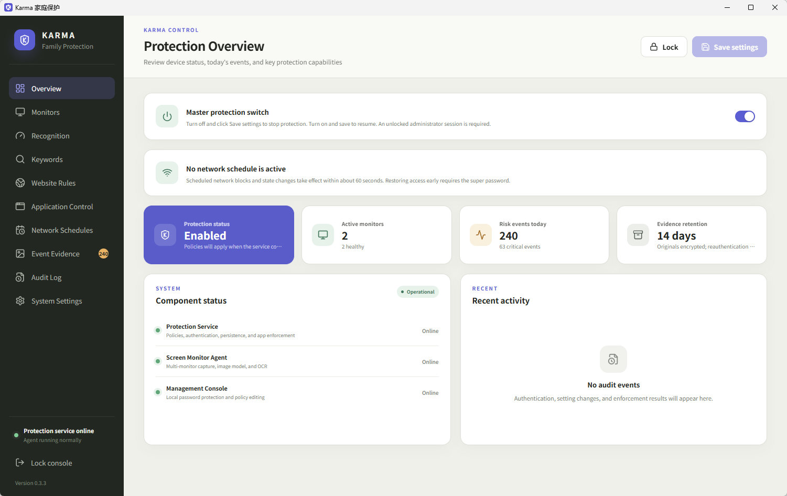

# Karma

[中文](README.md) · [Technical Overview](TECHNICAL.md) · [Windows Installation and Testing Guide (Chinese)](docs/windows-installation-guide.md)

Karma is a local pornography-protection and digital-wellbeing application for Windows (macOS is planned). It continuously monitors every display, closes the source application when it detects high-risk images or videos, and provides website and application allowlists/blocklists, blocking schedules, two-level passwords, audit logs, and protection against casual termination. All recognition runs on the device; screen content is never uploaded.



*The Windows management console's Protection Overview (v0.3.3)*

## Features

### Content Recognition and Enforcement

- **Real-time multi-display recognition**: each display is captured independently; a local ONNX model detects explicit images, and PP-OCRv5 models read Simplified Chinese, Traditional Chinese, and English text on screen. Continuously changing areas such as a video embedded in a web page or a shrunken player window are cropped and classified on their own, so they are not missed for covering only a small part of the screen; a small window of around 202×115 is read at the display's native resolution before it is enlarged for classification.
- **Precise source-application closing**: a match is attributed to the foreground window and process on that display, whose identity is rechecked before it is closed, so unrelated programs are left alone.
- **Window-title keywords**: a built-in list of 2,542 explicit terms in 26 languages (1,590 strict terms always active; 952 terms prone to false positives off by default and can be turned on) and 1,809 adult video code prefixes (such as SSIS or JUY, matched when followed by 3–4 digits with an optional hyphen or space, as in SSIS-123, SSIS 123, or SSIS123; 1,642 strict and 167 prone to false positives), plus custom enforced, sensitive, and exemption keywords, and keywords added to the built-in list.
- **Remembered window titles**: after image recognition closes a page, its title and host are remembered, and the same application showing the same title again is closed on sight. A misjudged title can be marked **Misjudged** so it is never remembered again.
- **Website allowlists and blocklists**: host discovery supports Chrome, Edge, Firefox, Brave, Opera/Opera GX, Vivaldi, Arc, 360, QQ, Sogou, Quark, and other known browsers, plus any application whose category is set to “Browser” in Application Control. Allowlisted sites are never closed by an image score; blocklisted sites close immediately. Rules cover subdomains.

### Application and Network Control

- **Application allowlists and blocklists**: an “Allow” application is never closed by image or title recognition (website blocklists still apply); an “Always block” application is closed whenever it reaches the foreground. Applications can be chosen from those installed on the computer or bulk-added.
- **Repeat-closure limits**: a program closed 5 times within 20 minutes is banned for one hour (window and count are configurable); bans survive reboots.
- **Application types**: besides the built-in Browser, Media player, Game, and Other categories, you can define new categories (such as “Chat apps”) and choose which programs belong to each, from the applications installed on the computer or by entering an executable. A closed application can also be put in a category directly from Audit Log → App closures.
- **Blocking schedules**: any number of blocked periods per weekday (including across midnight), targeting one or more application categories, selected applications, or all networked applications. Each rule either **blocks network access** (enforced by Windows WFP filters) or **blocks running** (during the period, the protection Service ends a blocked application as soon as it runs; Windows components and Karma itself are exempt).

### Administration and Self-Protection

- **Master protection switch**: the switch at the top of Protection Overview (also in System Settings) stops or resumes protection after **Save settings**; stopping protection requires the super password once one is set.
- **Two-level passwords**: the ordinary administrator password handles daily management; an optional super password, held by a supervisor, is required for anything that weakens protection.
- **Tamper resistance**: two Windows services guard each other; even administrators cannot stop or disable them from Services, Task Manager, or Registry Editor, and a killed service is restarted automatically.
- **Delayed uninstall**: uninstall needs the super password, or a request followed by a 72-hour wait and the administrator password.
- **Event evidence (optional)**: matched frames are stored encrypted and viewing an original requires the password again; a misattributed source application can be allowlisted in one click.
- **Secure automatic updates**: GitHub Releases are checked periodically, and only developer-signed packages with matching hashes and a strictly higher version are accepted; downgrades are refused.
- **Policy backups**: export policy to JSON; imports are validated for structure and correctness.
- **Chinese and English UI**: the console language is switchable, and the console starts in the background at sign-in by default; closing its window only hides it while protection continues.

## Installation

### Requirements

- Windows 10 22H2 x64 or Windows 11 x64, with an interactive desktop session;
- A GPU and driver supporting D3D11 and Windows Graphics Capture;
- Recommended: 4-core CPU, 8 GB RAM, and 2 GB free disk space;
- Windows administrator rights for installation.

### Using the Installer (Recommended)

1. Download the single-file installer `Karma-windows-x64-test-v0.3.21-setup.exe` from the [v0.3.21 Windows Test Build](https://github.com/csbuddhist/Karma/releases/tag/v0.3.21).
2. Right-click it and choose “Run as administrator”. Setup installs to `C:\Program Files\Karma`, verifies every file hash, registers and starts `KarmaService`, and creates desktop and Start menu shortcuts. It includes the official Microsoft Visual C++ 2015–2022 x64 Redistributable, verifies the Microsoft signature, and installs it silently only when the runtime is missing or older than 14.44.
3. Open the console from the “Karma 家庭保护” desktop shortcut or “Karma 管理控制台” in the Start menu, and create an administrator password of at least 10 characters on first connection.
4. Then set a super password in System Settings and hand it to the supervisor.

Because setup and the executables are not yet Authenticode-signed, Windows SmartScreen may warn about an “unknown publisher”. Do not permanently disable security software to install Karma.

### Upgrading

- **Automatic updates**: enabled by default (`updates.autoInstall`); the service checks GitHub Releases periodically, and the console can check immediately.
- **Manual upgrade**: with v0.2.4 or later installed, run the new installer and enter the administrator password to upgrade in place. The service verifies the signature and file hashes, then replaces files with rollback; protection services stay registered throughout. The console is closed during the upgrade; reopen it afterwards.
- v0.2.3 and earlier must be uninstalled with password authorization before installing the new version.

### Installing from the Repository

`main` retains the auditable **cloneable Windows test bundle** at [`release/windows-x64-test/`](release/windows-x64-test/). After cloning, run from that directory as administrator:

```powershell
Set-ExecutionPolicy -Scope Process Bypass
.\Install-Karma.ps1 -StartConsole
```

### Uninstalling

- Enter the super password to uninstall immediately; or
- Request uninstall in the console with the administrator password, wait **72 hours**, then uninstall with the administrator password during the following **24 hours**;
- Without a super password, the administrator password uninstalls with no wait.

Uninstall keeps local data by default. See the [Windows installation and testing guide](docs/windows-installation-guide.md) for detailed steps, diagnostics, and troubleshooting.

## Important Notes

### This Is a Test Build

- Only an unsigned Windows test build is available; it is not yet a complete product for production home deployment. The macOS version is still in design.
- Continuous-frame risk fusion is not finished; Windows hardware acceptance for GPU capture, ONNX inference, network enforcement, launch blocking, and updates is still in progress.
- Network blocking, policy changes, and lifting a block early take effect within about 60 seconds; launch blocking ends a blocked application within about 2 seconds, losing its unsaved work.
- If a browser hides its address bar or does not expose it to accessibility, Karma cannot identify the site for that window, but title and image recognition still work. Website rules match domains, not paths.
- The console does not yet expose a complete audit-log reader.
- Focused recognition covers only continuously changing areas: a small still image in a web page is still judged as part of the whole screen and can be missed when it covers too little of it.

### Recommended Setup

The protected person uses a standard Windows account daily, while the supervisor holds the Windows administrator account and the Karma super password.

### Passwords and Permissions

- Both the ordinary administrator password and the super password need at least 10 characters and must differ.
- Once a super password is set, **any change that weakens protection** requires it, including: disabling protection, recognition, or launching the console at sign-in; raising the image risk threshold; relaxing website/application/keyword/blocking-schedule/repeat-closure rules; forgetting a remembered title; deleting critical event evidence; lifting a block early; and immediate uninstall. Tightening protection needs only the ordinary administrator session.
- The service compares the **entire submitted policy**: if any part weakens protection, the whole save requires the super password. Direct service requests that bypass the console face the same checks.
- Changing the super password requires the current super password; the ordinary password cannot overwrite or clear it.
- Without a super password, the ordinary administrator session can perform all of the above.

<details>
<summary>Full permission table with a super password configured (since v0.2.4)</summary>

Entering the ordinary administrator password unlocks the console and creates an authenticated session. Most everyday actions use that session; the actions marked below require entering the ordinary password again.

| Area | Ordinary administrator password or session | Additional super password required |
| --- | --- | --- |
| Console and status | Unlock or lock the console; view Service/Agent/display health, policy, network state, current application bans, update status, and uninstall countdown; search and page through remembered titles, with the recognition reason for each; review titles marked as misjudged and let one be remembered again | Forgetting a remembered title, or marking it as misjudged |
| Ordinary administrator password | Change it after entering the current ordinary password again; the new password must have at least 10 characters and differ from the configured super password | No super password needed for this change |
| Super password setup | Set it for the first time after entering the ordinary password again; it must have at least 10 characters and differ from the ordinary password. The supervisor should enter and keep it | Changing an existing super password requires the current super password; the ordinary password cannot overwrite or clear it |
| Protection and recognition | Enable protection, image recognition, OCR, title matching, or remembered titles; lower the image risk threshold | Disable any of those switches, or raise the image risk threshold |
| Website rules | Add or enable block rules; remove or disable allow rules | Add or enable allow rules; remove, disable, or narrow block rules |
| Application rules | Add or enable “Always block” rules; remove or disable “Allow” rules. When adding an application, type its executable or choose one from the applications installed on this computer (read from the Windows installed-program and App Paths registrations and from Start menu and desktop shortcuts). Rules record only the program file name (.exe), so a rule still applies to a program with the same file name after it is moved or copied elsewhere | Add or enable “Allow” rules; remove, disable, or narrow “Always block” rules |
| Bulk add applications | Search the applications installed on this computer and check several at once; browsers (known browsers or application rules categorized as browsers) are marked and cannot be checked | Checked applications become “Allow” rules (an “Always block” rule matching one also becomes “Allow”). Like other application edits, they apply after **Save settings**, which needs the super password |
| Keywords | Add or enable enforced keywords; add keywords to the built-in list; turn on the built-in terms prone to false positives; remove or disable exemptions | Remove, disable, or replace enforced custom keywords; remove a keyword added to the built-in list; turn off the terms prone to false positives; add or enable exemptions |
| Blocking schedules | Add, enable, or extend blocked periods; expand blocked targets or add applications to a blocked category while preserving all existing coverage | Remove, disable, shorten, or move periods, change a rule's targets or its action (such as from blocking running to blocking network access), or move applications out of a blocked category in a way that reduces existing coverage; lift a block before it ends |
| Repeat-closure limits | Lengthen the counting window or reduce the number of closures needed to trigger a ban | Shorten the counting window or increase the number of closures needed |
| Currently restricted applications | View each restricted application and when its restriction ends | **Always allow**: one click sets that application to “Allow” in the application list (an “Always block” rule matching it also becomes “Allow”) and lifts its current restriction immediately. Browsers (known browsers or application rules categorized as browsers) cannot be allowed: the button is grayed out, the Service refuses the request, and the restriction ends when it expires. It is saved at once, separately from other unsaved edits, and audited |
| Event evidence | View and filter the evidence list, with the reason each item was saved; enter the ordinary password again to view each original; delete one or several selected high-risk items after confirming; enable or disable evidence saving; turn **Skip allowlisted applications** on or off (when on, the Service discards new evidence attributed to an application with an enabled “Allow” rule instead of saving it; saved evidence is kept) | Deleting critical evidence (risk score of at least 95%). A bulk deletion that includes any critical item requires the super password, or nothing in it is deleted. Forgetting a remembered title is a separate protected operation. **Add to allowlist**: after confirming, the application an evidence item was attributed to is added to Application control as “Allow” (an “Always block” rule matching it also becomes “Allow”) and any repeat-closure restriction on it is lifted. The Service takes the executable path from its own evidence record; evidence whose source application could not be attributed, or whose source is a browser (a known browser or an application rule categorized as a browser), cannot be allowlisted, and its button is grayed out. It is saved at once and audited |
| Policy backups | Export policy, import a backup for review, and save it when it preserves or strengthens protection | Saving an imported policy that weakens protection; importing does not bypass service authorization |
| Console preferences | Change the interface language; turn on starting the console at sign-in. Closing the console hides its window while protection continues | Turning off starting the console at sign-in, so a restart cannot leave the console closed |
| Software updates | Enable or disable automatic installation; check and install updates now; enter the ordinary password in setup to request an in-place upgrade | No super password needed. Every upgrade still requires a valid developer signature, matching file hashes, and a strictly higher version |
| Uninstall request | Enter the ordinary password again to request uninstall; cancel a request with the administrator session; after the 72-hour wait, enter the ordinary password to uninstall during the following 24 hours | Immediate uninstall before the waiting period has elapsed requires the super password |

The table describes authorization, not a guarantee that an operation can succeed regardless of state: updates and uninstall cannot execute concurrently, and session, validation, revision, and service-availability checks still apply. Policy changes take effect only after **Save settings**; renaming or reorganizing rules is allowed without the super password only when the Service's comparison finds no weakening.

</details>

### Forgotten Super Password

- There is no separate super-password reset or one-time recovery code; use the **delayed uninstall** route: request uninstall → wait 72 hours → uninstall with the administrator password during the following 24 hours. Requests survive reboots and can be cancelled; after cancellation or expiry, a new request is needed. Requests, readiness, cancellation, expiry, and uninstall approval are audited.
- Uninstall keeps local data by default, including the super-password hash, so reinstalling with that data retained does **not** reset the super password. For a fresh setup, run `Uninstall-Karma.ps1 -PurgeData` after uninstall is authorized, then reinstall. Purging permanently deletes the ordinary password, policy, audit records, bans, remembered titles, keys, and encrypted evidence.

### Privacy

- Screen content is processed in memory only; it is neither uploaded nor saved in its original form, and runtime logs never contain recognized text, scores, titles, URLs, or screen content.
- No root certificate is installed, HTTPS is not decrypted, and keyboard input and full URLs are not recorded.
- The following are stored encrypted on the device (AES-256-GCM, keys protected by Windows DPAPI): matched frames that reach the immediate-enforcement threshold when “Save event evidence” is on; and, for the remembered-title feature (on by default), window titles, hosts, and executable paths (at most 5,000). Deleting an evidence image does not remove a remembered title.
- Audit logs record only structured data such as time, application, enforcement result, and reason codes — never screen content or window titles. A closure caused by a window-title keyword also records the matched keyword, with its last Chinese character or last two English characters replaced by `*` (the first letter is kept).

### Lawful Use

Karma should be used only for content protection by device owners, guardians, or organizations acting within the scope of lawful authorization. Tell the protected person about screen monitoring, application enforcement, logging scope, and how uninstall works. Karma does not conceal monitoring, collect keyboard input, use screenshots for training, or bypass operating-system privacy prompts or device-owner permissions.

## More Documentation

- [Technical Overview](TECHNICAL.md): architecture, process topology, recognition, data encryption, IPC security boundaries, development builds, and the implementation roadmap.
- [Windows installation and testing guide](docs/windows-installation-guide.md)
- [Model assets](docs/model-assets.md)
- Hardware acceptance checklists: [frame pipeline](docs/windows-frame-pipeline-acceptance.md) · [ONNX](docs/windows-onnx-acceptance.md) · [network enforcement](docs/windows-network-enforcement-acceptance.md) · [updates](docs/windows-update-acceptance.md)

## Repository and License

The canonical repository is [csbuddhist/Karma](https://github.com/csbuddhist/Karma).

Karma source code is licensed under the GNU General Public License version 3 only (`GPL-3.0-only`); see [LICENSE](LICENSE). Third-party dependencies and model assets retain their respective licenses.
