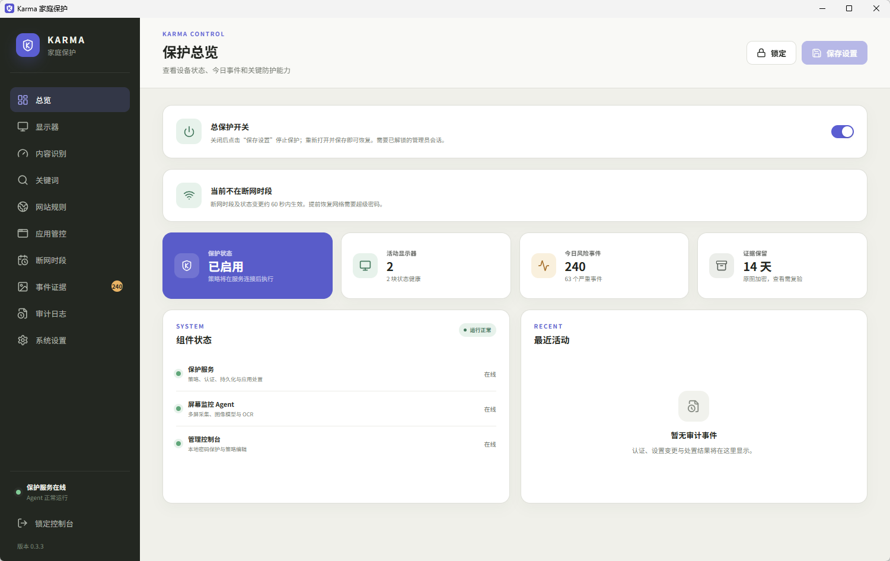

# Karma

[English](README.en.md) · [技术说明](技术说明.md) · [Windows 安装与测试指南](docs/windows-installation-guide.md)

Karma 是一款面向 Windows（macOS 规划中）的本地色情内容防护与数字健康软件。它持续监控所有显示器，识别到高风险图片或视频后关闭来源应用，并提供网址与应用黑白名单、断网时段、两级密码、审计日志和防随意退出能力。所有识别都在本机完成，屏幕画面不会上传。



*Windows 管理控制台的“保护总览”页（v0.3.3）*

## 功能特性

### 内容识别与处置

- **多显示器实时识别**：每个显示器独立采集画面，本地 ONNX 模型识别色情图像；PP-OCRv5 模型识别屏幕上的简体中文、繁体中文和英文文字。
- **精准关闭来源应用**：命中后定位该显示器上的前台窗口及其进程，二次核验进程身份后关闭，不误杀无关程序。
- **窗口标题关键词**：内置 26 种语言、2,543 个成人内容词（1,592 个严格词始终生效，951 个易误报词默认关闭、可手动开启）；支持自定义拦截词、敏感词、豁免词，并可向内置词库补充关键词。
- **记住窗口标题**：图像识别关闭某个页面后，记住其标题和域名，同一应用再次显示相同标题时直接关闭；误判的标题可标记为“误判”，以后不再记住。
- **网址黑白名单**：支持 Chrome、Edge、Firefox、Brave、Opera/Opera GX、Vivaldi、Arc 的域名识别。白名单网站不会因图像分数被关闭；黑名单网站立即关闭。规则覆盖子域名。

### 应用与上网管控

- **应用黑白名单**：“允许使用”的应用不会被图像或标题识别关闭（网址黑名单仍有效）；“始终禁止”的应用一出现在前台就被关闭。可从本机已安装的应用中选择或批量添加。
- **重复关闭限制**：同一程序在 20 分钟内被关闭 5 次后封禁 1 小时（时间窗口和次数可调），封禁跨重启有效。
- **断网时段**：为每周每天设置任意多个断网时段（支持跨午夜），对象可选浏览器、指定软件或全部联网应用，由 Windows WFP 过滤器执行。

### 管理与自我保护

- **总保护开关**：“保护总览”顶部可停止或恢复保护（“系统设置”中为同一开关），点击“保存设置”后生效；已设置超级密码时，停止保护需超级密码。
- **两级密码**：普通管理员密码负责日常管理；可选的超级密码由监督人保管，任何削弱保护的操作都需要它。
- **防篡改**：两个 Windows 服务互相守护，管理员也无法通过“服务”管理器、任务管理器或注册表编辑器停止或禁用；被强杀后自动拉起。
- **延时卸载**：卸载需超级密码，或申请后等待 72 小时再用管理员密码卸载。
- **事件证据（可选）**：命中画面经加密后保存，查看原图需再次输入密码；可一键把误判来源应用加入白名单。
- **安全自动更新**：定期检查 GitHub Releases，仅接受开发者签名、哈希一致且版本更高的升级包，禁止降级。
- **策略备份**：策略可导出为 JSON，导入时校验结构与合法性。
- **中英文界面**：控制台可切换语言，默认登录后在后台启动；关闭窗口只隐藏界面，保护继续运行。

## 安装方法

### 系统要求

- Windows 10 22H2 x64 或 Windows 11 x64，交互式桌面会话；
- 支持 D3D11 和 Windows Graphics Capture 的显卡及驱动；
- 建议 4 核 CPU、8 GB 内存、2 GB 可用磁盘空间；
- 安装需要 Windows 管理员权限。

### 使用安装器（推荐）

1. 从 [v0.3.8 Windows Test Build](https://github.com/csbuddhist/Karma/releases/tag/v0.3.8) 下载单文件安装器 `Karma-windows-x64-test-v0.3.8-setup.exe`。
2. 右键安装器，选择“以管理员身份运行”。安装器会把程序安装到 `C:\Program Files\Karma`，校验全部文件哈希，注册并启动 `KarmaService`，创建桌面和开始菜单快捷方式。安装器内置微软官方 Visual C++ 2015–2022 x64 运行库，校验微软签名后，仅在本机运行库缺失或低于 14.44 时静默安装。
3. 从桌面的“Karma 家庭保护”或开始菜单的“Karma 管理控制台”打开控制台，首次连接后创建至少 10 个字符的管理员密码。
4. 建议随后在“系统设置”中设置超级密码，交由监督人保管。

由于安装器和程序尚未进行 Authenticode 代码签名，Windows SmartScreen 可能提示“未知发布者”。请勿为了安装而永久关闭安全软件。

### 升级

- **自动更新**：默认开启（`updates.autoInstall`），服务定期检查 GitHub Releases；也可在控制台中立即检查。
- **手动升级**：已安装 v0.2.4 及以上版本时，直接运行新版安装器并输入管理员密码，即可原地升级。服务验签、复验文件哈希后带回滚地替换文件，保护服务全程保持注册。升级期间会关闭管理控制台，完成后重新打开即可。
- v0.2.3 及更早版本需先用密码授权卸载，再安装新版。

### 从仓库安装

`main` 分支保留可审查的 **cloneable Windows test bundle**：[`release/windows-x64-test/`](release/windows-x64-test/)。克隆仓库后，以管理员身份在该目录运行：

```powershell
Set-ExecutionPolicy -Scope Process Bypass
.\Install-Karma.ps1 -StartConsole
```

### 卸载

- 输入超级密码可立即卸载；
- 或在控制台用管理员密码申请卸载，等待 **72 小时**后，在随后的 **24 小时**内用管理员密码卸载；
- 未设置超级密码时，用管理员密码即可卸载，无需等待。

卸载默认保留本地数据。详细步骤、诊断方法和故障排查见 [Windows 安装与测试指南](docs/windows-installation-guide.md)。

## 注意事项

### 当前为测试版

- 目前仅提供 Windows 未签名测试版，尚不适合作为家庭正式部署的完整产品；macOS 版本仍处于设计阶段。
- 连续帧风险融合、按时段阻止应用启动等功能尚未完成；GPU 采集、ONNX 推理、网络执行和升级流程的 Windows 真机验收仍在进行中。
- 断网时段、策略修改和提前恢复网络最长约 60 秒后生效。
- 如果浏览器隐藏地址栏或未向辅助功能公开地址栏，Karma 无法识别该窗口的网址，但标题与图像识别仍然有效。网址规则只匹配域名，不匹配路径。
- 控制台暂未提供完整审计日志的查看入口。

### 防篡改能力的边界

Karma 收紧了两个 Windows 服务（KarmaService 及配套守护服务）的权限：在 services.msc 或任务管理器中“停止”、把“启动类型”改为“禁用”、在注册表编辑器中修改服务键值，即使是管理员也会被拒绝；两个服务每几秒互相守护；“结束任务”强杀后由服务控制管理器自动拉起。这足以挡住只会使用图形工具的非专业管理员。

但它**不能**保证抵御懂技术的管理员：使用 `sc.exe` 等终端命令、夺取服务或注册表键的所有权、进入安全模式或恢复环境、离线修改注册表、或拥有设备物理控制权，都可能绕过保护。真正抵御技术型管理员需要带签名的内核级保护（PPL/ELAM），当前测试版不包含。

**最有效的做法**：让被保护的人日常使用 Windows 标准用户账户，Windows 管理员账户和 Karma 超级密码由监督人保管。

### 密码与权限

- 普通管理员密码和超级密码都至少 10 个字符，且两者不能相同。
- 设置超级密码后，**任何削弱保护的修改**都需要超级密码，包括：关闭保护、识别功能或控制台登录后自动启动，提高图像风险阈值，放宽网址/应用/关键词/断网时段/重复关闭限制，删除已记住标题，提前恢复网络，立即卸载。加强保护只需普通管理员会话。
- 服务会比较**整份提交的策略**：只要其中一项削弱保护，整次保存就需要超级密码。直接绕过控制台请求服务，也执行同样的检查。
- 修改超级密码需要当前超级密码，普通密码无法覆盖或清空它。
- 未设置超级密码时，普通管理员会话即可执行上述操作。

<details>
<summary>已设置超级密码时的完整权限表（v0.2.4 起）</summary>

输入普通管理员密码解锁控制台后会建立已认证会话；多数日常操作使用该会话即可，表中注明的操作还会再次要求输入普通密码。

| 操作范围 | 普通管理员密码或会话可以执行 | 需要追加超级密码的操作 |
| --- | --- | --- |
| 控制台与状态 | 解锁、锁定控制台；查看服务、Agent、显示器健康、策略、网络状态、当前应用封禁、更新状态和卸载倒计时；分页查看和搜索已记住标题及每条的识别原因；查看已标记误判的标题，并可恢复记住 | 删除已记住标题，或将其标记为误判 |
| 普通管理员密码 | 再次输入当前普通密码后修改；新密码至少 10 个字符，且不能与已设置的超级密码相同 | 修改普通密码本身不需要超级密码 |
| 超级密码设置 | 再次输入普通密码后首次设置；超级密码至少 10 个字符，且与普通密码不同，应由监督人输入和保管 | 修改已有超级密码需要当前超级密码，普通密码不能覆盖或清空它 |
| 保护与内容识别 | 开启保护、图像识别、OCR、标题识别或记住标题；降低图像风险阈值 | 关闭上述任一开关，或提高图像风险阈值 |
| 网站规则 | 新增或启用黑名单；删除或停用白名单 | 新增或启用白名单；删除、停用或缩小黑名单范围 |
| 应用规则 | 新增或启用“始终禁止”；删除或停用“允许使用”。添加应用时可手动填写可执行文件，也可从本机已安装的应用中选择（读取 Windows 已安装程序与 App Paths 注册信息，以及开始菜单和桌面快捷方式） | 新增或启用“允许使用”；删除、停用或缩小“始终禁止”的范围 |
| 批量添加应用 | 搜索本机已安装的应用并一次勾选多个；浏览器（已知浏览器或类别为“浏览器”的应用规则）会被标出且不能勾选 | 勾选的应用设为“允许使用”（匹配它的“始终禁止”规则也会改为“允许使用”）。与其他应用规则修改一样，点击**保存设置**后生效，需要超级密码 |
| 关键词 | 新增或启用拦截关键词；向内置词库补充关键词；开启内置易误报词；删除或停用豁免词 | 删除、停用或替换已有自定义拦截关键词；删除补充到内置词库的关键词；关闭易误报词；新增或启用豁免词 |
| 断网时段 | 新增、启用、延长断网时段；扩大断网对象，且保留原有全部覆盖范围 | 删除、停用、缩短、移动时段或修改断网对象，导致原有断网覆盖减少；在时段结束前提前恢复网络 |
| 重复关闭限制 | 延长重复违规统计窗口，或降低触发封禁所需的关闭次数 | 缩短统计窗口，或提高触发封禁所需的关闭次数 |
| 当前被限制的应用 | 查看被限制的应用及解除时间 | **一键允许**：把该应用在应用列表中设为“允许使用”（匹配它的“始终禁止”规则也会改为“允许使用”），并立即解除当前限制。浏览器（已知浏览器或类别为“浏览器”的应用规则）不能一键允许：按钮显示为灰色，Service 也会拒绝，限制到期后自动解除。该操作立即保存，不会顺带保存其他未保存的修改，并写入审计 |
| 事件证据 | 查看和筛选证据列表及每条证据的保存原因；每次查看原图时再次输入普通密码；确认后删除单条或批量删除所选证据；开启或关闭证据保存；开启或关闭**不拦截白名单应用**（开启后，Service 直接丢弃来源为已启用“允许使用”规则应用的新证据，不再保存；已保存的证据不受影响） | 这些证据操作不需要超级密码；删除已记住标题是另一项受保护操作。**加入白名单**：确认后把该证据的来源应用加入“应用管控”列表并设为“允许使用”（匹配它的“始终禁止”规则也会改为“允许使用”），同时解除对它的重复关闭限制。可执行文件路径由 Service 从自身证据记录读取；来源应用无法可靠归属或为浏览器（已知浏览器或类别为“浏览器”的应用规则）的证据不能加入白名单，按钮显示为灰色。该操作立即保存并写入审计 |
| 策略备份 | 导出策略、导入备份供检查，并在不削弱保护时保存 | 保存会削弱保护的导入策略；导入不能绕过服务端授权 |
| 控制台偏好 | 修改界面语言、开启控制台登录后自动启动；关闭控制台只隐藏窗口，保护继续运行 | 关闭控制台登录后自动启动，防止通过重启使控制台不再运行 |
| 软件更新 | 开启或关闭自动安装；立即检查并安装更新；在安装器中输入普通密码申请原地升级 | 不需要超级密码，但所有升级仍须通过开发者签名、文件哈希和严格更高版本校验 |
| 卸载申请 | 再次输入普通密码提交申请；用管理员会话取消申请；等待 72 小时后，在随后的 24 小时内输入普通密码卸载 | 不等待申请生效、立即卸载需要超级密码 |

表格描述的是授权范围，不代表操作在任何状态下都一定成功：升级和卸载不能同时执行，会话、参数校验、策略版本和服务连接等检查仍然有效。策略修改需点击“保存设置”后生效；规则改名、整理等操作，也以服务比较后确认没有削弱为准。

</details>

### 忘记超级密码

- 当前没有独立的超级密码重置或一次性恢复码功能，请使用**延时卸载**途径恢复：申请卸载 → 等待 72 小时 → 在随后 24 小时内用管理员密码卸载。申请跨重启保留，可随时取消；取消或过期后需重新申请。申请、生效、取消、过期和卸载授权均写入审计。
- 卸载默认保留本地数据（包括超级密码哈希），保留数据后重装**不会**重置超级密码。如需完全重新初始化，应在卸载获得授权后执行 `Uninstall-Karma.ps1 -PurgeData`，再重新安装。清除数据会永久删除普通密码、策略、审计、封禁、已记住标题、密钥和加密证据。

### 隐私

- 屏幕画面只在内存中处理，不上传、不保存原始画面；运行日志不输出识别原文、分数、标题、网址或画面。
- 不安装根证书，不解密 HTTPS，不记录键盘输入和完整网址。
- 以下内容会在本机加密保存（AES-256-GCM，密钥由 Windows DPAPI 保护）：开启“保存事件证据”时达到立即处置阈值的命中画面；默认开启的“记住窗口标题”所记录的窗口标题、域名和程序路径（最多 5,000 条）。删除证据图片不会删除已记住标题。
- 审计日志只记录时间、应用、处置结果、原因码等结构化信息，不记录画面与窗口标题。

### 合规使用

Karma 只应由设备所有者、监护人或组织在合法授权范围内用于内容防护。请明确告知被保护者屏幕监控、应用处置、日志范围和卸载方式。本软件不会隐藏监控事实，不采集键盘输入，不将截图用于训练，也不绕过操作系统的隐私提示和设备所有者权限。

## 更多文档

- [技术说明](技术说明.md)：架构设计、进程拓扑、识别算法、数据加密、IPC 安全边界、开发构建与实施路线。
- [Windows 安装与测试指南](docs/windows-installation-guide.md)
- [模型资产说明](docs/model-assets.md)
- 真机验收清单：[帧管线](docs/windows-frame-pipeline-acceptance.md) · [ONNX](docs/windows-onnx-acceptance.md) · [网络执行](docs/windows-network-enforcement-acceptance.md) · [升级](docs/windows-update-acceptance.md)

## 代码仓库与许可证

项目主仓库为 [csbuddhist/Karma](https://github.com/csbuddhist/Karma)。

Karma 源代码采用 GNU 通用公共许可证第 3 版（仅限该版本，`GPL-3.0-only`），完整条款见 [LICENSE](LICENSE)。第三方依赖和模型资源保留各自的许可证。
